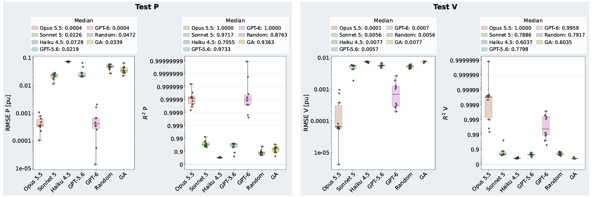
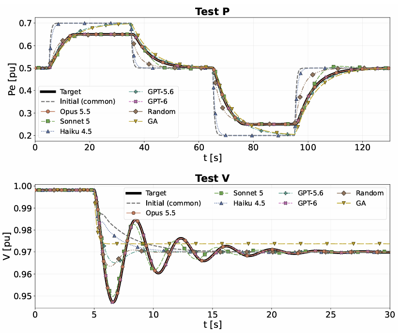

# TuneBench

A benchmark for LLM agents on **power system control tuning**. The agent
has to tune the controller parameters of a battery energy storage system
(BESS) in [ANDES](https://github.com/CURENT/andes) so that the simulated
response matches reference trajectories. It can only run simulations
through an MCP server, and it has a fixed simulation budget.

The BESS is modelled with the WECC generic renewable chain:

- **REGCA1**: converter/grid interface
- **REECA1**: electrical control
- **REPCA1**: plant-level control

## The task

The agent runs two tests **in sequence**, sharing a budget of **15 tuning
simulations** (`run_tds` calls), plus 2 extra verification runs:

| Test | Disturbance | Tuned parameters | Compared quantities | Target |
|---|---|---|---|---|
| **P** | Steps of the plant active power setpoint `REPCA1.Pline0` (0.5 → 0.7 → 0.5 → 0.2 → 0.5 pu, 130 s) | `PARAM_P` | P | `Target_P.csv` |
| **V** | Step of the plant voltage reference `REPCA1.Vref0` (→ 0.97 pu at 5 s, 30 s) | `PARAM_V` | V | `Target_V.csv` |

The best P parameters are frozen before the V test starts. At the end,
two out-of-budget `final_check` runs re-run both tests with the complete
final configuration.

Each run is scored by RMSE, max absolute error and R² after linear
interpolation onto the target time grid. The best P run has the lowest
`RMSE_P`. The best V run has the lowest `RMSE_Q + RMSE_V`. In both cases a
5 % tie-break on max error applies.

The agent also has to produce a fixed set of deliverables: per-run
outputs and metrics, summaries, a step log, an error log, a final report,
a cost estimate and a Plotly dashboard.

The full specification, which is also the prompt given to the agent, is
in [DESCRIPTION.txt](DESCRIPTION.txt). The per-test MCP call sequences
are in [SIMULATION_setpoint_P.md](SIMULATION_setpoint_P.md) and
[SIMULATION_setpoint_V.md](SIMULATION_setpoint_V.md).

## Repository layout

| Path | Content |
|---|---|
| `DESCRIPTION.txt` | Task statement / agent prompt (rules, budget, metrics, deliverables) |
| `SIMULATION_setpoint_P.md` | Instructions for the active-power setpoint test |
| `SIMULATION_setpoint_V.md` | Instructions for the voltage setpoint test |
| `test_grid.json` | ANDES case: BESS connected to an infinite bus through a single line |
| `Target_P.csv` | Reference trajectories for the P test (`t_s`, `REGCA1.Pe`, `REGCA1.Qe`) |
| `Target_V.csv` | Reference trajectories for the V test (`t_s`, `REGCA1.Pe`, `REGCA1.Qe`, `REGCA1.v`) |
| `andes_mcp/` | MCP server exposing ANDES (load case, set parameters, events, power flow, TDS, export) |
| `.mcp.json` | MCP server configuration for Claude Code (simulation budget, audit log) |
| `CLAUDE.md`, `.claude/settings.json` | Operating rules and permissions for Claude Code |
| `requirements.txt` | Python dependencies |

## Installation

Requires Python 3.10 or later.

```bash
git clone <this-repo-url> TuneBench
cd TuneBench
pip install -r requirements.txt
```

The server uses the `mcp.server.mcpserver.MCPServer` API from the MCP
Python SDK v2 (`mcp>=2.0`).

## Running the benchmark with Claude Code

1. Open the repository folder in Claude Code. `.mcp.json` registers the
   `andes` MCP server, which is started with `python -m andes_mcp.server`
   from the repository root. If your interpreter is not called `python`,
   edit `command` in `.mcp.json` and the interpreter name in
   `DESCRIPTION.txt` and `CLAUDE.md`.
2. Give the agent the content of `DESCRIPTION.txt` as the prompt. You can
   also just ask it to read and execute that file.
3. The agent writes all its outputs to the `RUN_FOLDER` named at the top of
   `DESCRIPTION.txt` (default `RUN1`). For an independent repetition,
   change that name (`RUN2`, `RUN3`, ...) and restart the MCP server, so
   that the simulation counter is reset.

### Budget enforcement and audit

Two environment variables in `.mcp.json` configure the server:

- `ANDES_MCP_MAX_TDS` (default in this repo: `17`) is the maximum number
  of `run_tds` calls per server session. Further calls are rejected. `0`
  means unlimited.
- `ANDES_MCP_TDS_LOG` is a JSON Lines file. The server appends one record
  per `run_tds` call: sequential number, case, `tf`, convergence, Alter
  events, and all REGCA1/REECA1/REPCA1 parameters. You can use it to check
  externally what the agent actually simulated. Consider pointing it
  outside the working folder, so that the agent cannot read it.

The counter lives in the server process. It is **not** reset by
`load_case`, only by restarting the server.

## Using the MCP server with other clients

The server is a standard stdio MCP server and does not depend on the
benchmark. To use it with any MCP client:

```bash
python -m andes_mcp.server
```

Available tools: `load_case`, `get_system_summary`, `list_models`,
`list_devices`, `get_device_params`, `list_variables`, `set_param`,
`add_device`, `add_alter`, `add_fault`, `add_toggle`, `setup`,
`run_power_flow`, `configure_tds`, `run_tds`, `export_results`.

A typical sequence is: `load_case` → `set_param` / `add_alter` →
`setup` → `run_power_flow` → `configure_tds` → `run_tds` →
`export_results`. `setup` can be called only once per loaded case, so
every new simulation starts again from `load_case`.

## Results

Five **LLM agents** (Opus 5.5, Sonnet 5, Haiku 4.5, GPT-5.6, GPT-6) were run
on the benchmark over repeated independent runs, and compared with two
non-LLM baselines with the same simulation budget: random search
(**Random**) and a genetic algorithm (**GA**).



Distribution over runs of RMSE and R² of the best run, for the P test
(active power) and the V test (voltage). Median values:

| Method | RMSE P [pu] | R² P | RMSE V [pu] | R² V |
|---|---|---|---|---|
| Opus 5.5 | 0.0004 | 1.0000 | 0.0001 | 1.0000 |
| GPT-6 | 0.0004 | 1.0000 | 0.0007 | 0.9959 |
| GPT-5.6 | 0.0219 | 0.9733 | 0.0057 | 0.7798 |
| Sonnet 5 | 0.0226 | 0.9717 | 0.0056 | 0.7886 |
| GA | 0.0339 | 0.9363 | 0.0077 | 0.6035 |
| Random | 0.0472 | 0.8763 | 0.0056 | 0.7917 |
| Haiku 4.5 | 0.0729 | 0.7055 | 0.0077 | 0.6037 |

Opus 5.5 and GPT-6 are the only methods that reach an almost exact match
in the P test (RMSE around 4·10⁻⁴ pu). In the V test, where 27 parameters
have to be tuned and the target response is oscillatory, Opus 5.5 is the
only method that consistently reproduces the target (median R² ≈ 1),
with GPT-6 second. The other agents perform similarly to the random
search and the genetic algorithm, and Haiku 4.5 does not improve over
the GA baseline.



Simulated trajectories compared with the target and with the common
initial parameter set: active power `Pe` in the P test (top) and voltage
`V` in the V test (bottom). The initial configuration and the weaker
methods miss the ramp-rate limited power response and the damped
voltage oscillation after the `Vref` step, which Opus 5.5 and GPT-6
follow closely.

## How to cite

If you use TuneBench, please cite:

> A. Pomarico, S. Tessitore, G. Giannuzzi and A. Berizzi, "TuneBench: Can
> AI Agents Calibrate Power System Dynamic Models?", submitted to IEEE PES
> General Meeting 2027.

```bibtex
@misc{pomarico2026tunebench,
  title  = {{TuneBench}: Can {AI} Agents Calibrate Power System Dynamic Models?},
  author = {Pomarico, Andrea and Tessitore, Salvatore and Giannuzzi, Giorgio and Berizzi, Alberto},
  year   = {2026},
  note   = {Submitted to IEEE PES General Meeting 2027}
}
```
